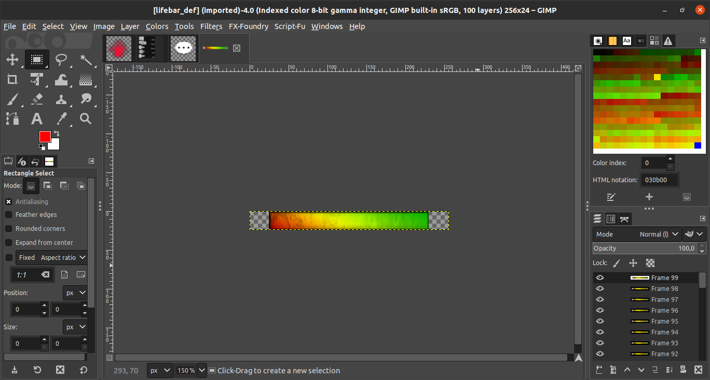
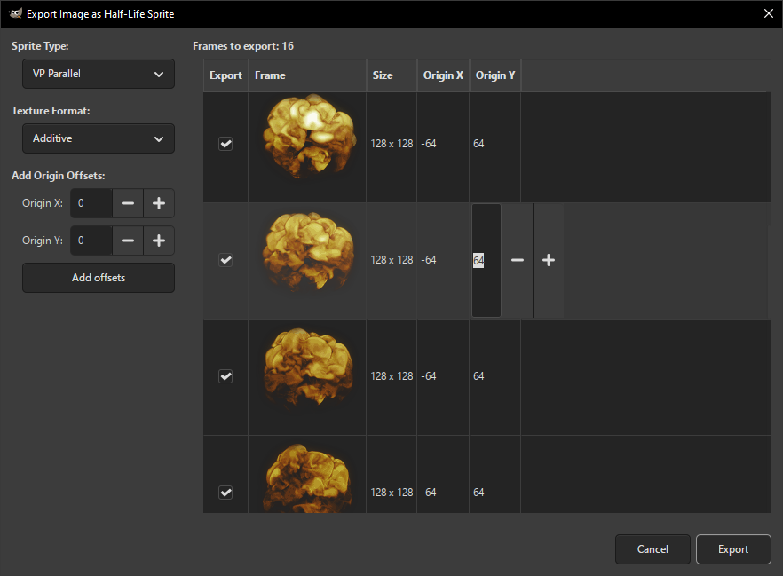

# Half-Life sprite plugin for GIMP
GIMP plugin that allows you to import and export sprites from a Half-Life game. This plugin can also open new version sprites containing DDS textures used in Counter-Strike Online (*Experimantal feature*).

## Requirements
1. [GIMP](https://www.gimp.org/), GIMP 3.2.8

For GIMP 2.10, use the [gimp-2.10](https://github.com/Psycrow101/GIMP-hl-sprite-plugin/tree/gimp-2.10) branch.

## Installation
Download and extract the `file-spr` folder to GIMP's `plug-ins` folder:
	**Windows**: `C:\Users\<USERNAME>\AppData\Roaming\GIMP\3.2\plug-ins`
	**Linux**: `/home/<USERNAME>/.config/GIMP/3.2/plug-ins`
	**macOS**: `/Users/<USERNAME>/Library/Application Support/GIMP/3.2/plug-ins`

*If you can’t locate the `plug-ins` folder, open GIMP and go to Edit > Preferences > Folders > Plug-Ins and use one of the listed folders.*

## Usage
To import `.spr` file into GIMP, go to File > Open.

To export image as `.spr` file from GIMP, go to File > Export As then enter the file name with `*.spr` extension and click *Export*.
In the dialog box that appears, you can configure the exported sprite.

In this version of the plugin, export of frame groups is supported only if you have previously imported a sprite containing frame groups and have not changed the color indexing mode. Otherwise, the layer groups will be merged.

## See also
[GIMP plugin for converting an image to Half-Life alphatest mode](https://github.com/Psycrow101/GIMP-hl-alphatest-plugin)
